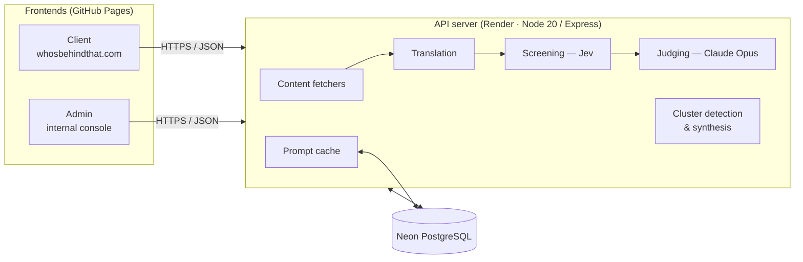

# Who's Behind That? — Architecture

**Doc version:** 1.1.0 · Reflects server v2.7.0 · admin v2.30.0 · client v1.20.0 · chatbot v1.2.0

Who's Behind That? (WBT) is an AI-powered narrative alignment analysis tool. Given a social media post or news article, it identifies whose agenda the content serves — and, across multiple posts, whether they form a coordinated narrative. It focuses on the Israeli-Palestinian conflict and Israeli domestic politics, and is designed and built by a single developer.

Live at [whosbehindthat.com](https://whosbehindthat.com).

**Documentation map**

| Doc | Covers |
|---|---|
| This document | The whole system: components, pipelines, data model, environments |
| [Server decisions](SERVER_DECISIONS.md) | Scoring engine, fetching, transcription, clustering, versioning |
| [Client overview](https://github.com/haimglikman/whos-behind-that-client/blob/main/docs/CLIENT_OVERVIEW.md) · [decisions](https://github.com/haimglikman/whos-behind-that-client/blob/main/docs/CLIENT_DECISIONS.md) | The public app |
| [Admin overview](https://github.com/haimglikman/whos-behind-that-admin/blob/main/docs/ADMIN_OVERVIEW.md) · [decisions](https://github.com/haimglikman/whos-behind-that-admin/blob/main/docs/ADMIN_DECISIONS.md) | The operator console |

## System overview

| Component | Repo | Hosting | Role |
|---|---|---|---|
| Client | `whos-behind-that-client` | GitHub Pages (custom domain) | Public app: scan posts, research actors, investigate clusters, FAQ |
| Admin | `whos-behind-that-admin` | GitHub Pages | Operator console: all users' data, entity database, prompts, models, FAQ editor, stats, Instagram carousel generator |
| Server | `whos-behind-that-server` | Render | Fetching, translation, AI scoring, cluster detection, persistence |
| Chatbot | `wbt-chatbot` | Render (API) + GitHub Pages ([ask.whosbehindthat.com](https://ask.whosbehindthat.com)) | Answers questions about how WBT was built, grounded in these repos' docs and changelogs; logs each exchange to the server |
| Database | — | Neon (serverless PostgreSQL) | Scans, clusters, actors, entities, prompts, FAQ, usage |

Each frontend is a single self-contained HTML file with no build step. The server is a single ES-module `server.js` with five npm dependencies (`express`, `cors`, `pg`, `cheerio`, `node-fetch`).

**Data-visibility principle:** the admin sees all data from all clients; a client sees only its own.

## Scan pipeline (single post)

1. **Fetch** — the server detects the platform from the URL and extracts text and metadata:
   - X: oEmbed · Facebook / Instagram: OpenGraph scraping with multiple user agents · Telegram: public post page and embed widget
   - News: three-tier fetch — basic headers → full browser-like headers → Archive.org fallback; any URL with a non-root path is attempted
   - Video (YouTube, TikTok, Instagram, Facebook, X, Telegram): transcript via TranscriptAPI (YouTube) or yt-dlp audio + Groq Whisper, plus caption, hashtags and account
   - Manual paste is always available for private or paywalled content
2. **Translate** — Hebrew and Arabic content is translated to English (Claude Haiku) before screening.
3. **Screen (Jev)** — Jev, a classification model (TypeSafe, via OpenRouter), answers three literal questions per entity in one request: is it *mentioned*, *criticized*, *praised*? This produces a shortlist.
4. **Judge (Claude Opus)** — one structured-output call scores the shortlist, using calibration anchors and rules for adversarial framing and quoted clips. It also receives a names-only list of all other entities, so it can add beneficiaries the post never mentions. The final score is computed in code, not by the model.
5. **Persist** — the scan is stored with scan ID, app / server versions, models used, and Claude and Jev token counts.

If Jev is unavailable, every entity goes straight to the judge.

## Investigation pipeline (multiple posts)

1. The user collects posts into an investigation basket.
2. **Pair screening** — Jev pre-screens post pairs; only likely connections reach Claude.
3. **Connection check** — Claude classifies each candidate connection; weak connections are discarded.
4. **Clustering** — connected posts form clusters. Clusters of three or more posts get a membership review, so chained links cannot merge unrelated narratives.
5. **Coordination evidence** — computed in code (near-identical wording, same account, shared links and hashtags, bot-flagged authors), then fed into the synopsis.
6. **Synopsis** — Claude writes the cluster narrative: frame, event, and whose interests it serves.

## Supporting systems

- **Entity database** — the political actors that posts are scored against. It is versioned, edited in admin, pushed to the server DB, and loaded by the client on page load (with a built-in default as fallback).
- **Prompt management** — prompts live in the DB with version history, model selection, and live activation from admin. An in-memory cache refreshes on save.
- **Actor research** — Claude with web search profiles the post's author, including a bot-probability estimate with reasoning.
- **Monitoring** — per-scan token and model tracking, a `jev_usage` table, `/stats`, client version registration, and `/system/info`, which reports the models and services actually in use without exposing secrets.
- **Instagram carousel generator** (admin) — renders 1080×1080 slides from saved cluster data with the HTML Canvas API, and exports them as a ZIP with JSZip.

## Data model (PostgreSQL)

| Table | Holds |
|---|---|
| `scans` | Every post scan: text, results, platform, source (admin / client), hashed device ID, versions, tokens, models |
| `clusters` | Investigations: frame, event, posts, connections, summaries |
| `actors` | Actor and publication research results |
| `entities` | The versioned entity database |
| `prompts` | Versioned prompts with model and active flag |
| `faq` | FAQ entries, grouped (Terminology, Scanning logic, Technical, Privacy) |
| `client_sessions` | Client versions per device |
| `jev_usage` | Jev calls and tokens |
| `usage_quota` | Daily usage counters per hashed device ID and IP |
| `chatbot_log` | Questions and answers from the chatbot, with sources, status, version, tokens and latency |

Schema changes are additive and apply automatically on startup.

## Environments and delivery

- **Production:** `whos-behind-that-{client,admin,server}`
- **Development:** `whos-behind-that-{client,admin,server}-dev` are separate repos and deployments, used to build and test major features (the Jev + Opus engine, clusters) before they are promoted to production
- Pushing to a repo deploys it: GitHub Pages for the frontends, Render for the server
- **Versioning:** each component has its own semantic version. Every changelog entry names the matching versions of the other two components. Versions only move forward — a rollback ships as a new version.

## Privacy and security

- No login and no cookies; an anonymous device ID lives in local storage and is hashed server-side.
- All API keys are server-side environment variables; the browser never sees them.
- Operator endpoints (prompt, entity and FAQ writes, entity refresh, scan comments, and reads that expose all users' data) require an admin key (`X-Admin-Key`, checked against `ADMIN_KEY`). Without the variable set, they are refused.
- Daily quotas are enforced on the server: 10 scans per device and 30 per IP (successful scans only), and 20 investigation calls per IP. Admin requests are exempt.
